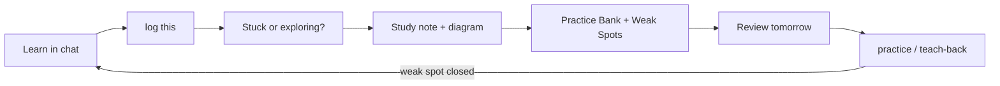

# LearnLoop

Turn what you learn in AI chats into Notion study notes, weak spots, practice
and job-ready proof.

You learn a topic in Claude, ChatGPT or Gemini. You say **"log this in
notion"**. LearnLoop writes a full study note with a diagram, records where you
got stuck, adds interview questions and a drill for your target role, and
schedules your first review for tomorrow. Then it tells you the next step, so
you never have to remember what comes after a note.

Why this exists and how it was designed: [docs/CASE-STUDY.md](docs/CASE-STUDY.md).



## Contents

- [What you get](#what-you-get)
- [Install](#install)
- [First-time setup](#first-time-setup)
- [Daily use](#daily-use)
- [All commands](#all-commands)
- [What a note looks like](#what-a-note-looks-like)
- [Your Notion workspace](#your-notion-workspace)
- [How struggle detection works](#how-struggle-detection-works)
- [Review schedule](#review-schedule)
- [When something is missing](#when-something-is-missing)
- [Troubleshooting](#troubleshooting)
- [Privacy](#privacy)
- [Project layout](#project-layout)
- [Development](#development)
- [Status](#status)

## What you get

From one `log this`:

- **A full study note**, not a chat summary. It explains the topic properly and
  marks anything the chat did not cover as "Beyond the chat".
- **A visual by default**: a flowchart, sequence diagram, comparison table or
  before/after table, chosen to fit the topic.
- **A "Where I got stuck" box** for concepts you confirm you were stuck on,
  with your own question trail, your misconception and what finally clicked.
- **An "Apply it now" section** for your target role: where the topic shows up
  on the job, interview questions with difficulty, a 30-minute drill, a
  mini-project and a teach-back prompt.
- **Records created for you**: the questions go to a Practice Bank, the project
  to Project Ideas, stuck concepts to Weak Spots, and the first review is set
  for tomorrow.
- **Optional extras**: a comparison table, a quiz or flashcards, added after
  the detailed note.

Logging the same topic again updates the existing note with a "Revisited"
section instead of creating a duplicate.

## Install

You need two things: the skill in your AI tool, and Notion connected to that
tool. No file needs editing.

| Tool | Install the skill | Connect Notion |
|---|---|---|
| Claude app (web, desktop) | Download `learnloop-public.zip` from [Releases](https://github.com/surbhi-bhor/learnloop-skill/releases). In Settings, Capabilities, turn on code execution, then upload the zip under Skills | Settings, Connectors, Notion |
| Claude Code | `npx skills add surbhi-bhor/learnloop-skill -a claude-code -g` | `claude mcp add --transport http notion https://mcp.notion.com/mcp` |
| Codex | `npx skills add surbhi-bhor/learnloop-skill -a codex -g` | Add the Notion MCP server in Codex settings |
| Gemini CLI, Cursor, others | `npx skills add surbhi-bhor/learnloop-skill`, then pick your tool | Add the Notion MCP server (`https://mcp.notion.com/mcp`) |
| ChatGPT or Gemini web | No install. Paste the prompt in [`paste-in-prompt.md`](learnloop/references/paste-in-prompt.md) at the end of a learning chat | Use the app's Notion connector if it has one; otherwise you get the note in the chat |

Manual install: copy the `learnloop/` folder into your tool's skills folder
(for Claude Code, `~/.claude/skills/learnloop/`).

Python 3.11 or newer makes struggle scoring exact. Without Python the skill
still works and scores by hand.

## First-time setup

Do these once, in order.

**1. Create your Notion workspace.** Say:

> set up learnloop

The skill creates a private `LearnLoop` page with a Profile page, seven
databases and saved views. It takes about a minute. You can move the page
anywhere in Notion later, but keep its name, because the skill finds it by
name.

**2. Import your profile.** Say:

> profile import

and attach your resume, or paste your LinkedIn text or portfolio. The skill
pulls out only facts that are in the material (roles, skills, projects), shows
them to you, and asks for your target role and preferred teaching style. It
writes the Profile page only after you confirm. From then on, every note's
"Apply it now" section is written for your target role.

**3. Optional: turn on reminders.** In the Claude app, add this line to
Settings, Profile, personal preferences:

> When I finish learning a topic, offer to log it with learnloop.

Claude will then offer to log a topic even when you forget to ask.

## Daily use

**1. Learn normally.** Ask questions, ask for examples, say when you are lost.
There is nothing special to do.

> What is an idempotent load? ... I still don't get why a retry duplicates
> rows ... can you show it step by step?

**2. Log it.** When you are done, say any of these:

> log this · log this in notion · save this to notion · note this down

**3. Answer two quick questions.** The skill shows what it noticed and asks:

> You asked about **retries and duplicates** 3 times and said "I still don't
> get it". Were you stuck, or just exploring?
>
> The detailed note with diagrams is always written. Do you also want a
> comparison table, quiz or flashcards added?

Answer "stuck" if you really were. Answer "exploring" if you were just
curious; that is recorded too and keeps the flags honest.

**4. Read the report.** You get the Notion link, the number of weak spots
recorded, how long logging took, and one next step:

> Want to try the 30-minute drill now? Your delayed teach-back is due tomorrow.
> You also have 2 reviews due. Say "review" to do them.

**5. Come back tomorrow.** Say "review". The skill asks you to recall before it
shows any answers, grades you, and schedules the next review.

## All commands

You do not need exact wording; these are examples.

| Say | What happens |
|---|---|
| `log this` | Turns the current chat into a note, practice records and review dates |
| `log this from <file>` | Same, from an exported chat (ChatGPT or Claude `conversations.json`, or pasted text with "You:" and "ChatGPT:" labels) |
| `set up learnloop` | Creates the Notion workspace |
| `profile import` | Builds your Profile from a resume, LinkedIn text or portfolio |
| `teach me <topic>` | Explains a topic with a visual and a check question |
| `teach me <topic> like Bollywood` | Same, in a named style. Styles: Plain language, New to this topic, Like I'm 5, Bridge from my experience, Gossip, Bollywood, Production war story, or your own |
| `how is <topic> used at work?` | A reality card: how the topic is used in your target role, real failure cases and trade-offs, with sources |
| `practice` or `quiz me` | Questions from your Practice Bank, graded strictly against fixed key points |
| `teach-back <topic>` | You explain the topic; it grades you with a quote for each key point |
| `review` or `what's due?` | Topics and weak spots due today, recall first |
| `jd-check` + a job description | Which requirements your notes and practice cover, and where the gaps are |

## What a note looks like

Every note has the same shape, so you always know where to look:

1. **Where I got stuck** (only if you confirmed being stuck)
2. **In 30 seconds**, plus why it matters for your target role
3. **Key idea**
4. **Picture it**: the diagram or visual table
5. **How it works**, with worked examples and real output
6. **When to use it, and when not**
7. **Gotchas**
8. **Check yourself**, answers hidden in a toggle
9. **Your extra format**, if you chose one
10. **Apply it now**: where it shows up on the job, interview questions, a
    30-minute drill, a mini-project, a teach-back prompt
11. **Cheat sheet**

Anything the chat did not cover is marked "Beyond the chat", so you know which
parts you have not actually studied yet.

## Your Notion workspace

`set up learnloop` creates these under one private `LearnLoop` page:

| Database | What it holds |
|---|---|
| Learning Log | One row per topic, with the note as its page |
| Weak Spots | Each concept you were stuck on, until a delayed teach-back passes |
| Practice Bank | Interview questions and drills, with key points for grading |
| Project Ideas | Mini-projects suggested by your notes |
| Reality Cards | How topics are used in real jobs |
| Evidence Ledger | Proof points for your resume, kept as Draft until you confirm |
| Skill Map | Requirements from job descriptions, matched to your learning |

Saved views do the remembering for you: **Due today**, **Open weak spots**,
**Learned but never applied**, **Flagged**, **What worked** and **Gaps**.

## How struggle detection works

The AI groups your messages by concept. A script then counts five signals for
each concept:

| Signal | Example |
|---|---|
| Repeated | You asked about it 3 or more times |
| Simplify request | "explain it simpler", "give me an example", "step by step" |
| Wrong summary | You restated it incorrectly ("so a retry makes it idempotent") |
| Hints needed | You needed 2 or more hints on a check question |
| Said stuck | "I still don't get it", "I'm lost" |

A concept is flagged at 2 or more signals, or whenever you said you were stuck.
The flag is only a suggestion: you confirm "stuck" or "just exploring" before
anything is recorded.

## Review schedule

| Kind | When it comes back |
|---|---|
| Regular topic | 1 day, then 1 week, then 1 month |
| Weak spot | 1 day, then 3, 7 and 14 days until it passes |

A weak spot closes only when you pass a teach-back at least one day later,
without rereading the note. Getting it right straight after the explanation
does not count.

## When something is missing

| Missing | What happens |
|---|---|
| Nothing | Full flow |
| Python | Struggle is scored by hand with the same rules, and the note says "Scored by hand, not by script" |
| Notion | You get the complete note in the chat, with a clear message that it was not saved |
| A clock | "Minutes to log" is left empty instead of guessed |

## Troubleshooting

**The skill did not start when I said "log this".** Check the skill is
enabled in your tool. In the Claude app, also check code execution is on.
Saying "use learnloop to log this" always works.

**"Notion tools are not available" even though Notion is connected.** Some apps
load connector tools only when asked, and a chat can end up with only some of
them. Start a new chat and try again. If it still fails, check that the
Notion connector allows search, fetch, create pages and update page.

**It created a second LearnLoop workspace.** The skill finds your workspace by
the page name `LearnLoop`. If you renamed the page, rename it back.

**The portfolio import found nothing.** Sites built with JavaScript often show
only a title to the AI. Paste the text of your portfolio instead.

**A diagram shows as code.** Notion renders `mermaid` code blocks as diagrams.
Some chat apps do not; the note includes a plain text version for those.

## Privacy

- Your Notion workspace is created as a private page.
- Only the chat turns a note needs are quoted; full transcripts are never
  copied into Notion.
- The skill never invents your history, achievements, numbers or job
  requirements. Resume evidence stays as Draft until you confirm it.
- Exported chats you test with belong in `private-chats/`, which git ignores.

## Project layout

```
learnloop/                 the skill (this is what gets installed)
  SKILL.md                 commands and workflow
  references/              note template, Notion schema, rubrics, role packs
  scripts/                 transcript parser, struggle scorer, metrics report
  agents/openai.yaml       display info for Codex
AGENTS.md, CLAUDE.md,      adapters when this repo is opened in Codex,
GEMINI.md                  Claude Code or Gemini CLI
tests/                     script tests and a trigger check
tools/package_skill.py     validates the skill and builds the zip
docs/                      case study, testing and release checklists
```

## Development

```
python -m pytest -q                      # script tests
python tools/package_skill.py --public   # build dist/learnloop-public.zip
```

`tools/package_skill.py` checks the frontmatter, description length, file
encoding and referenced files before it builds the zip. Without `--public` the
zip also contains your local `config.local.json` (your Notion IDs); keep that
version private. Save files as UTF-8 without a byte-order mark.

## Status

Version 0.1. The scripts are tested and the full flow has been run end to end
on a synthetic chat. Struggle scoring, cross-tool activation and style
tracking still need checking on real conversations; see
[`docs/TESTING.md`](docs/TESTING.md) and [`docs/baseline-log.md`](docs/baseline-log.md).
Role packs are starting points, not verified job requirements.

Issues and ideas are welcome in
[GitHub Issues](https://github.com/surbhi-bhor/learnloop-skill/issues).

## License

MIT. See [`LICENSE`](LICENSE).
