# Case study: LearnLoop

How I turned a habit that wasn't working (copying AI chat answers into Notion)
into a learning loop that remembers the next step for me.

## Summary

I learn most new topics by talking to AI tools: Claude, ChatGPT, Gemini. The
explanations were good, but very little of it lasted. LearnLoop is an agent
skill that turns one learning chat into a full study note, a record of where I
got stuck, practice tied to the jobs I am targeting, and a review schedule, all
from a single command: "log this in notion".

| | |
|---|---|
| **Role** | Designer and builder |
| **Target user** | Anyone learning technical topics through AI chats, starting with me (aiming at senior BI and data engineering roles) |
| **Built with** | Agent Skills format, Notion MCP, Python standard library, built with Claude Code and Codex |
| **Status** | v0.1, tested on synthetic data, real-chat validation in progress |

## The problem

My learning routine had five failures, and each one was small enough to
ignore on its own:

1. **Copying was slow.** After a good chat I copied the useful parts into
   Notion by hand and tidied them up. That took long enough that I often
   skipped it.
2. **The notes were passive.** A pasted chat is a trail of partial answers. A
   week later it did not teach me the topic; it reminded me that I once read
   about it.
3. **The hard parts disappeared.** The most valuable moment in a learning chat
   is where I got stuck and what finally made it click. Cleaned-up notes
   removed exactly that.
4. **Learning stayed separate from the job.** I would understand a concept and
   still not know how it is asked in a data engineering interview, or how to
   use it in a project.
5. **I did not remember the next step.** Practice, review and applying the
   topic all depended on me remembering to do them. Mostly I did not.

The last point shaped the whole design. A tool that needs me to run five
commands in the right order is just a longer to-do list. It had to do the work
in one step and then tell me what to do next.

## Goals and non-goals

**Goals**

- One command from chat to a complete, reviewable note.
- Capture struggle, but only with my confirmation.
- Connect every topic to a target role: interview questions, a drill, a
  project.
- Schedule reviews and practice automatically, and nudge me toward them.
- Work in whichever AI tool I happen to be using.

**Non-goals**

- Not a new chat app or tutor. The learning happens wherever it already
  happens.
- Not a claim about "learning styles". Styles are presentation choices, and
  the system measures which ones led to a passed teach-back rather than
  assuming.
- Not a resume generator. It never invents achievements or numbers.

## Key design decisions

### 1. One command, then one suggested next step

`log this` writes the note, the practice questions, the drill, the project
idea, the weak spots and the first review date in one go. The report at the
end is under six lines and offers exactly one next action, such as "Want to
try the 30-minute drill now?"

*Why:* the problem was forgetting, not lack of features. Every extra decision
I have to make is a place where the loop breaks.

*Trade-off:* each log creates several records at once. To keep that from
becoming clutter, logging the same topic twice updates the existing note
instead of duplicating it.

### 2. The AI judges meaning, a script does the counting

Struggle detection is split in two. The model groups my messages into
concepts and spots wrong summaries, which needs understanding. A small Python
script then counts five signals per concept (repeated questions, requests to
simplify, a wrong summary, hints needed, saying I was stuck) and applies fixed
thresholds.

*Why:* if the model both reads and scores, the same chat can get a different
score each time. Fixing the counting in code makes scores repeatable and
measurable. If a score looks wrong, the grouping is wrong, and the fix is to
regroup, not to adjust the number.

*Trade-off:* the phrase lists are English only and miss unusual wording. The
model's grouping and my confirmation catch most of what the phrases miss.

### 3. "Stuck, or just exploring?"

A flag is a suggestion, never a verdict. Before anything is written, the skill
asks about all flagged concepts in one message. Asking many questions can mean
curiosity, and a system that labels curiosity as weakness would quickly be
ignored.

*Why:* it keeps the Weak Spots list trustworthy, and every answer is recorded,
so flag accuracy can be measured over time.

### 4. A real study note, not a chat summary

An early version produced tidy summaries of the chat. They were accurate and
not useful. The note template now requires the topic to be explained properly:
the mechanism, a worked example with real output, when to use it, gotchas, and
check questions with hidden answers. Anything the chat did not cover is marked
"Beyond the chat", so I know which parts I have not actually studied.

Every note also has a visual by default. The template maps the shape of an
idea to a visual: a pipeline becomes a flowchart, messages between systems a
sequence diagram, a choice between options a comparison table, data before and
after an operation two small tables. When I was stuck, the diagram is drawn
around the exact point of confusion.

### 5. "Apply it now" in every note

Each note ends with where the topic shows up in my target role, interview
questions with difficulty and why they are asked, a 30-minute drill, a
mini-project and a teach-back prompt. The questions and drill are saved to a
Practice Bank right away, with the key points a correct answer must contain.

*Why:* applying a topic is the step I skipped most. Creating the practice at
the moment of learning, instead of waiting for me to ask, removes that step.

### 6. Strict grading and delayed proof

Teach-backs are graded against key points fixed before I answer, with a quote
from my answer for each point. When unsure, the grade defaults to "Needs work".
A weak spot closes only after a teach-back passes at least one day later,
without rereading the note.

*Why:* an AI grader is naturally lenient, and getting something right straight
after the explanation shows short-term memory, not understanding. Without
these rules, the "resolved" count would be a vanity number.

### 7. Honest data only

The skill never invents learner history, achievements, metrics or job
requirements. Profile facts are extracted from my resume and confirmed by me
before they are saved. Time saved is measured with the system clock, never
estimated; with no clock, the field stays empty. Role packs are labeled as
starting points until checked against real job descriptions.

*Why:* this project feeds a resume and interview prep. One invented number
would make the whole record untrustworthy.

### 8. Work in any agent, degrade cleanly

The skill follows the open Agent Skills format, so the same folder installs in
Claude, Claude Code, Codex, Gemini CLI and Cursor with `npx skills add`. For
chat apps that cannot load skills, a paste-in prompt carries the same rules.

It also fails gracefully: without Python it scores by hand with the same
rules and labels the result; without Notion it gives the full note in the
chat; with no config file it finds the workspace in Notion by name, or offers
to create one.

### 9. Remember past doubts, not just past topics

Matching notes by topic name was not enough. The same doubt often comes back
weeks later under a different topic: "late data" in a Kafka chat, then
"late-arriving facts" in a lakehouse chat. So before writing a note, the
skill searches past weak spots by meaning and compares the actual questions
and misconceptions. A confirmed repeat updates the existing weak spot (a
"Times stuck" count, the date, and links to every topic it appeared in)
instead of creating a new one, and the note opens with an "Asked before" box
quoting what clicked last time. Repeat doubts get their own view and are
reviewed first. When I start a topic I studied before, the skill offers a
two-minute recall check before explaining again.

*Why:* re-asking the same question without noticing is the clearest sign of
a real gap, and the one I am least likely to catch myself.

*Trade-off:* matching by meaning can produce false matches. The rule is that
sharing a keyword is not enough; it must be the same question or the same
misconception, and when unsure it does not count.

## Iterations after first use

Using the skill on real learning sessions changed it. Each change below came
from something that went wrong or felt missing.

| What I noticed | What changed |
|---|---|
| Notes were text only, harder to scan for visual learners | Every note now has a "Picture it" visual chosen by the shape of the idea: flowchart, sequence diagram, comparison table or before/after table |
| Choosing Quiz or Flashcards replaced the detailed note | The detailed note is always written; formats are added after it |
| The skill needed a config file with my Notion IDs, so nobody else could install it as-is | It now finds the workspace by name or offers to create one, and installs in any agent with `npx skills add` |
| Some agents cannot run Python | Struggle is scored by hand with the same rules and labelled "Scored by hand, not by script" |
| ChatGPT and Gemini web cannot load skills | The paste-in prompt was brought up to the same rules: signal table, stuck box, visuals, production section |
| In the Claude app, the Notion tools sometimes did not load | The skill now names the exact tools to search for, and gives the note to paste when they still fail |
| "Minutes to log" showed 12 seconds for a note drafted in an earlier attempt | The field is left empty when a note is only being saved, not measured end to end |
| Notes said where a topic shows up in a job but not how it runs or breaks | "Apply it now" gained an "In production" part: real usage, a typical failure, and how to catch it |
| Without a profile, notes guessed my target role | Profile import now reads the resume and portfolio, and mini-projects build on my own project |
| I could re-ask an old doubt without anyone noticing | "Seen before" detection, described in decision 9 |

## How it works

```mermaid
flowchart TD
    A["Chat"] --> B["Parse turns"]
    B --> C["Model groups turns into concepts"]
    C --> D["Script scores 5 signals"]
    D --> E{"Flagged?"}
    E -->|yes| F["Ask: stuck or exploring?"]
    E -->|no| G["Write note"]
    F --> G
    G --> H["Learning Log"]
    G --> I["Practice Bank + Project Ideas"]
    F -->|stuck| J["Weak Spots"]
    H --> K["Review views"]
    J --> K
```

Notion holds everything in seven related databases: Learning Log, Weak Spots,
Practice Bank, Project Ideas, Reality Cards, Evidence Ledger and Skill Map.
Saved views such as "Due today", "Open weak spots" and "Learned but never
applied" replace the need to remember anything.

## What was hard

- **Making notes useful, not just correct.** The first notes were faithful
  summaries that did not teach. Fixing that meant rewriting the template
  around how a learner rereads a note weeks later.
- **Getting the skill to trigger.** A skill only helps if the AI loads it. The
  description had to name the exact phrases people use ("log this", "save
  this to notion", "note this down"). A trigger test across 16 queries went
  from 14 to 16 after rewriting it.
- **Not guessing numbers.** An early run reported logging time as 3 minutes;
  the measured time was under one. That is why time now comes only from the
  clock.
- **Tool and file quirks.** Files saved with a hidden byte-order mark broke
  the Claude app upload. A Notion workspace created by one agent was
  invisible to another agent's connector. Both led to safeguards: a packager
  that validates encoding and frontmatter, and workspace discovery by name.
- **Scope.** Halfway through, the project drifted toward job-search features.
  I pulled it back to the original idea, the one-step log with "Apply it
  now", and put the extra features on hold until the core works on real use.

## How success will be measured

Nothing below is claimed yet; these are the targets for the validation phase.

| Question | Measure | Target |
|---|---|---|
| Are flags right? | Flags I confirm as stuck / all flags | 80% or higher |
| Are stuck moments caught? | My annotated stuck moments that were flagged | 70% or higher |
| Does it avoid false alarms? | Confirmed flags on a chat with no real struggle | Zero |
| Does it save time? | Minutes to log vs my timed manual baseline | Lower than manual |
| Does it lead to practice? | Topics with at least one practice attempt | Tracked over weeks |
| Do weak spots get fixed? | Weak spots closed by a delayed teach-back | Tracked over weeks |
| Do repeat doubts stop repeating? | Weak spots that reach Times stuck 3 | Falling over time |

The baseline is manual timings plus three annotated chats where I got stuck
and one where I did not.

## What I learned

- **Design for the user who forgets.** The most useful feature is not a
  feature at all; it is removing the need to remember the next step.
- **Split judgment from counting.** Let the model do what needs
  understanding, and let code do what needs to be repeatable.
- **Ask before labeling people.** One confirmation question made the struggle
  data trustworthy.
- **Make the honest path the default.** Empty fields beat guessed ones when
  the data feeds decisions about your career.

## What's next

1. Validate struggle detection on real chats against the targets above.
2. Use it daily for several weeks and measure time saved, practice rate and
   weak spots closed.
3. Only then, build on the data the loop collects, for example a proof pack
   that links a job description's requirements to the notes, practice and
   projects that cover them.
