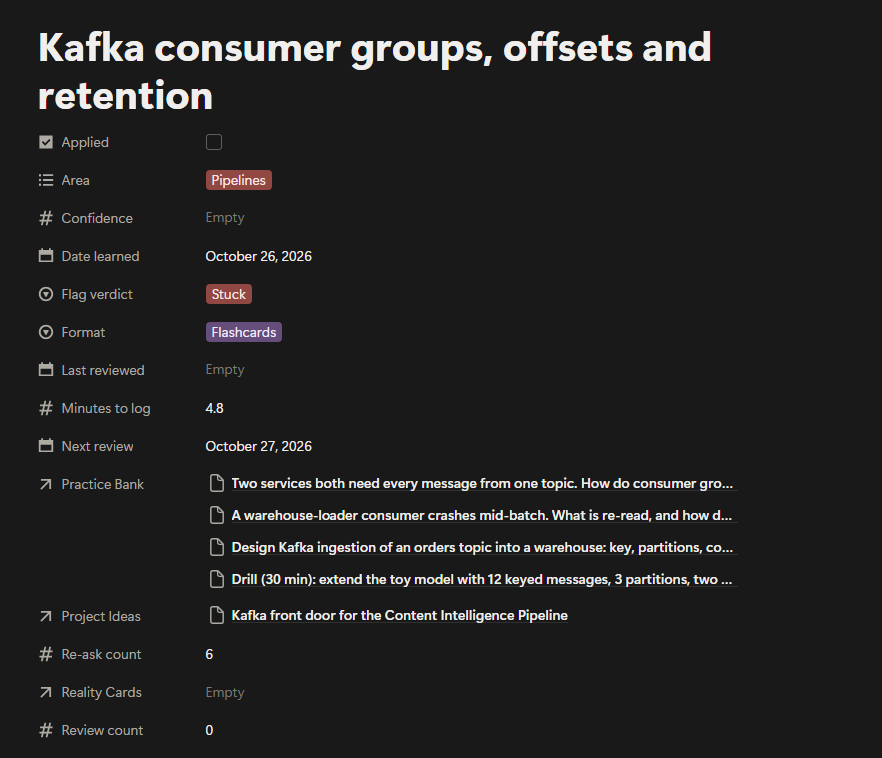
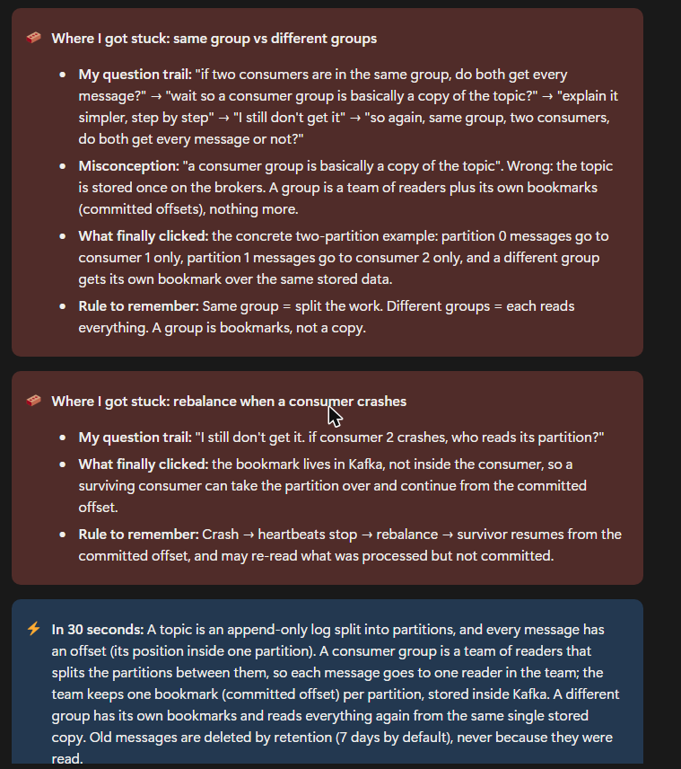
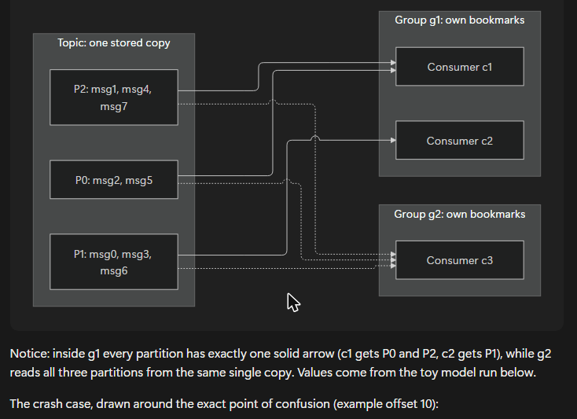
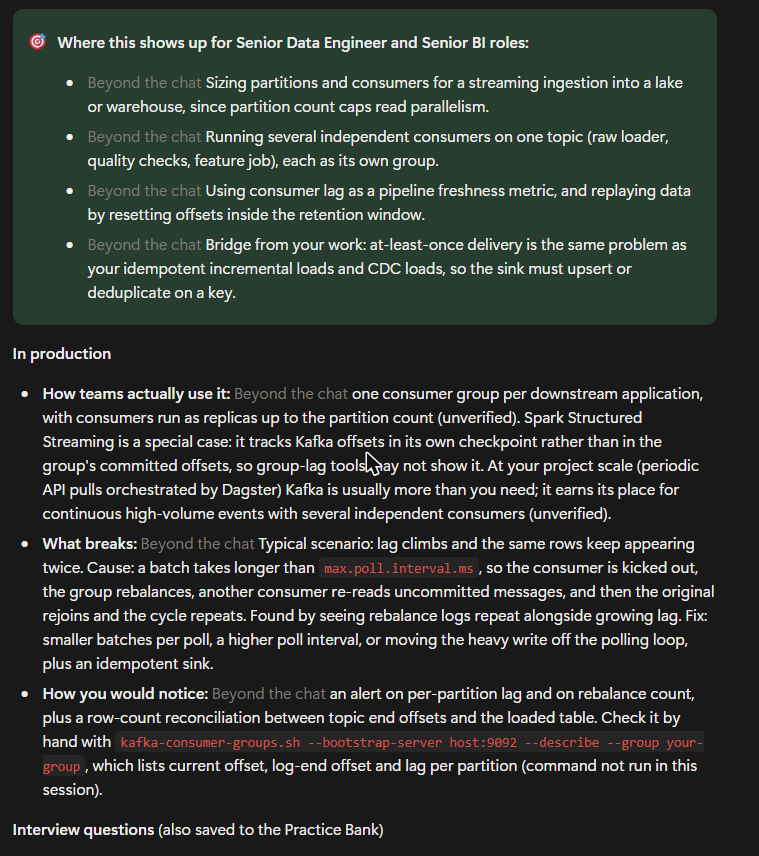
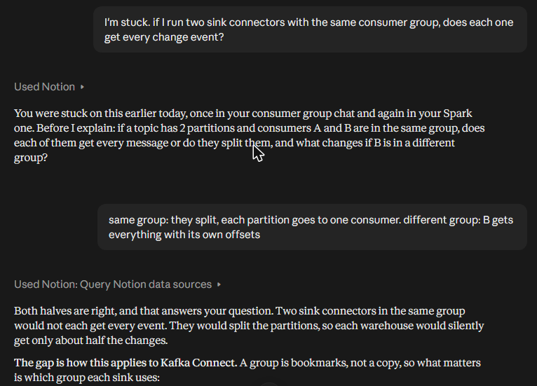
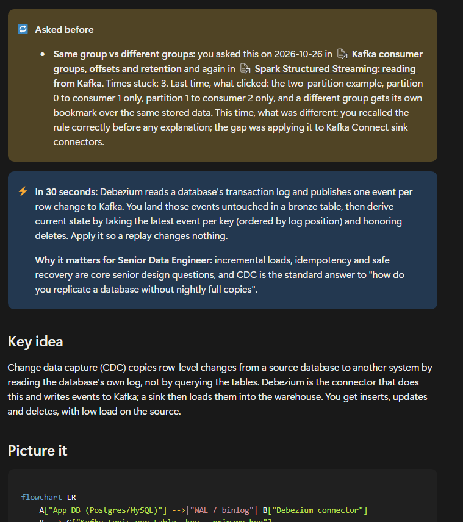
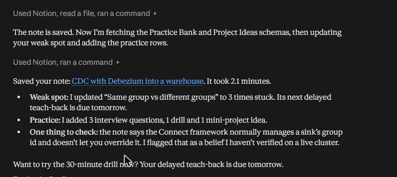

# Example: one doubt, three chats

A real run of LearnLoop in the Claude app with Notion connected, recorded on
2026-10-26. It shows the full loop on one topic, Kafka consumer groups, and
what happens when the same doubt comes back in later chats under different
topics.

Nothing here is edited except for length. The screenshots are from the
learner's own Notion workspace and Claude chats.

- [Chat 1: learn a new topic and log it](#chat-1-learn-a-new-topic-and-log-it)
- [Chat 2: the same doubt under Spark](#chat-2-the-same-doubt-under-spark)
- [Chat 3: the same doubt under Debezium, caught mid-chat](#chat-3-the-same-doubt-under-debezium-caught-mid-chat)
- [What the weak spot looked like after each chat](#what-the-weak-spot-looked-like-after-each-chat)
- [The full note](note.md)

## Chat 1: learn a new topic and log it

The learner asked these questions in order, as anyone would while learning:

| # | Learner typed | Signal it produced |
|---|---|---|
| 1 | `teach me kafka consumer groups and offsets` | |
| 2 | `if two consumers are in the same group, do both get every message?` | |
| 3 | `wait so a consumer group is basically a copy of the topic?` | Wrong summary |
| 4 | `explain it simpler, step by step` | Simplify request |
| 5 | `I still don't get it. if consumer 2 crashes, who reads its partition?` | Said stuck |
| 6 | `so again, same group, two consumers, do both get every message or not?` | Repeated (asked 3+ times) |
| 7 to 9 | Three questions on retention | None (curiosity) |
| 10 | `log this` | |

Before writing anything, LearnLoop showed what it noticed and asked:

> **Same group vs different groups.** Score 3 of 3. You asked it 5 times in
> different forms ... You also said "a consumer group is basically a copy of
> the topic?", which I'm recording as a misconception.
>
> The retention questions scored 1 and are not flagged.
>
> Stuck, or just exploring? ... Do you also want a Comparison table, a Quiz
> or Flashcards added?

The learner answered `consumer groups: stuck. rebalance: stuck too.
retention: just exploring. add flashcards`. About five minutes later the note
was in Notion.

**Properties.** It was flagged Stuck, 4 practice items were created, a
project idea was added and the first review is set for tomorrow.



**Where I got stuck.** These boxes come first on the page and quote the
learner's own words, including the misconception.



**Picture it.** The diagram is drawn around the exact confusion: one stored
copy, and each group with its own bookmarks.



**Apply it now.** This part covers where the topic shows up in the target
role, how it runs in production, what typically breaks and how to notice.
Everything the chat did not cover is marked "Beyond the chat".



The whole note, converted to GitHub Markdown, is in [note.md](note.md).

## Chat 2: the same doubt under Spark

A new chat about a different topic:

```
teach me how spark structured streaming reads from kafka
wait, if I run two spark jobs with the same group id, do both get every message? I still don't get this
explain again simpler
log this
```

At `log this`, LearnLoop matched the doubt to the existing weak spot by
meaning, not by topic name:

> Repeat: this is close to your Weak Spot "Same group vs different groups:
> who gets which message", logged earlier today under Kafka consumer groups,
> offsets and retention. What clicked there was the two-partition example ...

After the learner said `stuck`, it updated the existing row instead of adding
a new one: Times stuck went to 2, and the Spark note was linked under Seen in.

## Chat 3: the same doubt under Debezium, caught mid-chat

A third chat, on CDC. This time the repeat was caught at the moment of
confusion, before any explanation. LearnLoop asked a recall question and
waited:



The learner answered correctly, so it explained only the gap (how Kafka
Connect names its groups) and then showed the rule to remember. The note for
this chat opens with an "Asked before" box:



And the report after `log this`:



## What the weak spot looked like after each chat

| After | Times stuck | Seen in | Next review |
|---|---|---|---|
| Chat 1 (Kafka) | 1 | | Tomorrow |
| Chat 2 (Spark) | 2 | Spark note | Tomorrow |
| Chat 3 (Debezium) | 3 | Spark note, Debezium note | Tomorrow |

The question trail on the row keeps every phrasing with its date, so the
learner can see the same gap across three topics. `what's due?` now puts this
weak spot first. It closes only when a teach-back passes at least one day
later, without rereading the note.

## Try it yourself

1. Install LearnLoop and connect Notion ([Install](../../README.md#install)).
2. Say `set up learnloop` once.
3. Learn any topic and be honest when you are lost. Then say `log this`.
4. A few days later, ask about the same confusion under another topic and
   watch for the recall question.
