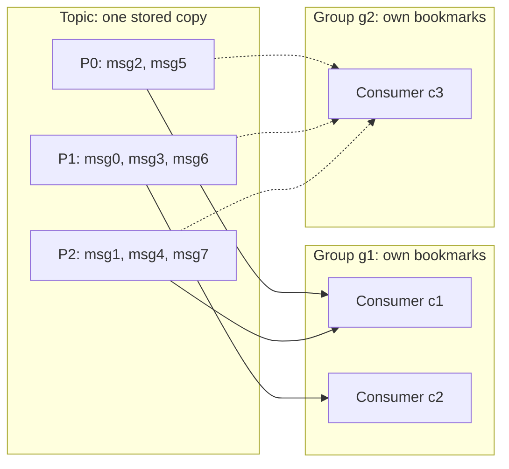
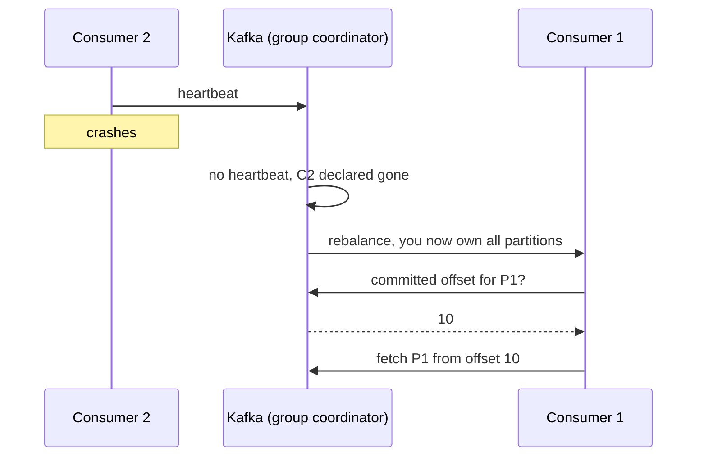

# Kafka consumer groups, offsets and retention

This is the note LearnLoop wrote to Notion for [Chat 1](README.md#chat-1-learn-a-new-topic-and-log-it),
converted to GitHub Markdown. Notion callouts appear as quotes and Notion
toggles as expandable sections. *Beyond the chat* marks parts the chat did
not cover.

| Property | Value |
|---|---|
| Flag verdict | Stuck |
| Struggle score | 3 |
| Re-ask count | 6 |
| Format | Flashcards |
| Style used | Plain language first |
| Minutes to log | 4.8 |
| Next review | Next day |

---

> 🧱 **Where I got stuck: same group vs different groups**
>
> - **My question trail:** "if two consumers are in the same group, do both get every message?" → "wait so a consumer group is basically a copy of the topic?" → "explain it simpler, step by step" → "I still don't get it" → "so again, same group, two consumers, do both get every message or not?"
> - **Misconception:** "a consumer group is basically a copy of the topic". Wrong: the topic is stored once on the brokers. A group is a team of readers plus its own bookmarks (committed offsets), nothing more.
> - **What finally clicked:** the concrete two-partition example: partition 0 messages go to consumer 1 only, partition 1 messages go to consumer 2 only, and a different group gets its own bookmark over the same stored data.
> - **Rule to remember:** Same group = split the work. Different groups = each reads everything. A group is bookmarks, not a copy.

> 🧱 **Where I got stuck: rebalance when a consumer crashes**
>
> - **My question trail:** "I still don't get it. if consumer 2 crashes, who reads its partition?"
> - **What finally clicked:** the bookmark lives in Kafka, not inside the consumer, so a surviving consumer can take the partition over and continue from the committed offset.
> - **Rule to remember:** Crash → heartbeats stop → rebalance → survivor resumes from the committed offset, and may re-read what was processed but not committed.

> ⚡ **In 30 seconds:** A topic is an append-only log split into partitions, and every message has an offset (its position inside one partition). A consumer group is a team of readers that splits the partitions between them, so each message goes to one reader in the team; the team keeps one bookmark (committed offset) per partition, stored inside Kafka. A different group has its own bookmarks and reads everything again from the same single stored copy. Old messages are deleted by retention (7 days by default), never because they were read.
>
> **Why it matters for Senior Data Engineer and Senior BI roles:** partition count caps how fast a pipeline can read, and the commit strategy decides whether a crash leaves duplicates or lost data in the warehouse.

## Key idea

Kafka stores messages once, in partitions. A consumer group copies nothing: it is a team of readers plus a set of bookmarks. Inside a group each partition has exactly one reader, so work is shared and nothing is read twice by the group. Separate groups each read everything, at their own pace.

Scope: consumer groups, offsets and retention basics as discussed. Transactions, exactly-once delivery and Kafka Streams are out of scope.

## Picture it



Notice: inside g1 every partition has exactly one solid arrow (c1 gets P0 and P2, c2 gets P1), while g2 reads all three partitions from the same single copy. Values come from the toy model run below.

The crash case, drawn around the exact point of confusion (example offset 10):



Notice: the bookmark (offset 10) is kept by Kafka, so the survivor does not need anything from the dead consumer.

## How it works

1. Producers append messages to partitions. Each message gets the next offset in that partition (offsets are per partition, not global).
2. A group's consumers split the partitions between them. A rebalance re-deals partitions whenever a consumer joins, leaves or crashes. Useful consumers in one group = at most the number of partitions; extras sit idle.
3. A consumer reads and commits offsets. The committed offset is the next message the group will read, stored in the internal topic `__consumer_offsets`.
4. After a crash or restart, the new owner reads the committed offset and continues from there. Lag = latest offset minus committed offset.
5. A second group has its own committed offsets, so with no bookmark it starts per `auto.offset.reset` (earliest = from the start, latest = only new messages).

Worked example: a toy model run in the chat (partitions are lists, bookmarks are a dict, round-robin assignment). It is not real Kafka: no coordinator, no heartbeats.

```python
def assign(consumers):                      # spread partitions over consumers
    out = {c: [] for c in consumers}
    for p in topic:
        out[consumers[p % len(consumers)]].append(p)
    return out
```

```text
1 consumer in group 'g1': {'c1': [0, 1, 2]}
2 consumers (rebalance):   {'c1': [0, 2], 'c2': [1]}
4 consumers (1 sits idle): {'c1': [0], 'c2': [1], 'c3': [2], 'c4': []}
```

With 3 partitions, a 4th consumer gets nothing.

```text
lag before: {0: 2, 1: 3, 2: 3}
c1 polls p0: [(0, 0, 'msg2'), (0, 1, 'msg5')]
lag after : {0: 0, 1: 3, 2: 3}
c1 crashes, restarts, polls p0 again: []
other group 'g2' starts fresh on p0: [(0, 0, 'msg2'), (0, 1, 'msg5')]
```

The restarted consumer gets nothing because its bookmark survived. Group g2 has no bookmark, so it reads from the start.

**When to commit.** Commit after processing = at-least-once: a crash causes duplicates, so make the sink idempotent. Commit before processing = at-most-once: a crash can lose messages.

**Retention.**

- Default is 7 days (`log.retention.hours=168`). `log.retention.bytes` defaults to -1, so there is no size limit.
- Each topic can override it with `retention.ms` and `retention.bytes` (bytes is per partition). `-1` keeps data forever.
- Deletion is by whole segment file, only once everything in the segment is old enough, so a message can outlive the limit a little. Reading never deletes anything.
- Offsets do not renumber after deletion. If a bookmark points at a deleted offset, `auto.offset.reset` decides: earliest = oldest remaining, latest = jump to the end, none = error.
- *Beyond the chat:* Kafka decides a consumer is dead when heartbeats stop for `session.timeout.ms`, or when it does not call poll again within `max.poll.interval.ms`. Either one triggers a rebalance.

## When to use it, and when not

- One consumer group per application (billing, analytics, warehouse loader). Two systems that both need every message must be in different groups.
- Scale a group by adding consumers up to the partition count. Beyond that, extra consumers do nothing.
- *Beyond the chat:* Adding partitions later raises the parallelism limit, but it also changes which partition a key maps to for new messages and triggers a rebalance.
- Retention: short for noisy logs, long for important events, compaction when only the latest value per key matters, an archive copy when you need history.

## Gotchas

- More consumers than partitions in one group: the extras sit idle.
- Commit before processing loses data on a crash; commit after processing gives duplicates. Pick on purpose and make the sink idempotent.
- A slow group can fall off the retention cliff: if its lag grows past the retention window, unread messages are deleted and `auto.offset.reset` silently decides where it restarts.
- Order is guaranteed only inside one partition. The same key always lands in the same partition.

## Check yourself

1. Within one consumer group, can two consumers read the same partition at the same time?
2. A consumer fetches messages 45 to 50 of a partition, commits offset 51, then crashes before processing them. What happens to messages 45 to 50?
3. A topic has 3-day retention. Your warehouse loader group was down for 5 days and restarts with `auto.offset.reset=latest`. What happens to the data, and how would you have noticed earlier?

<details>
<summary>Answers</summary>

1. No. Each partition goes to exactly one consumer per group. A second consumer only gets it after a rebalance.
2. They are never processed: the new owner starts at the committed offset. This is at-most-once (data loss).
3. The committed offset points to deleted data, so the reset policy applies. With `latest` the loader jumps to the end and silently skips everything it never read. A lag alert and a row-count reconciliation against the source would have shown the gap.

</details>

## Apply it now

> 🎯 **Where this shows up for Senior Data Engineer and Senior BI roles:**
>
> - *Beyond the chat:* Sizing partitions and consumers for a streaming ingestion into a lake or warehouse, since partition count caps read parallelism.
> - *Beyond the chat:* Running several independent consumers on one topic (raw loader, quality checks, feature job), each as its own group.
> - *Beyond the chat:* Using consumer lag as a pipeline freshness metric, and replaying data by resetting offsets inside the retention window.
> - *Beyond the chat:* Bridge from your work: at-least-once delivery is the same problem as your idempotent incremental loads and CDC loads, so the sink must upsert or deduplicate on a key.

**In production**

- **How teams actually use it:** *Beyond the chat:* one consumer group per downstream application, with consumers run as replicas up to the partition count (unverified). Spark Structured Streaming is a special case: it tracks Kafka offsets in its own checkpoint rather than in the group's committed offsets. At a small project's scale, Kafka is usually more than you need (unverified).
- **What breaks:** *Beyond the chat:* Typical scenario: lag climbs and the same rows keep appearing twice. Cause: a batch takes longer than `max.poll.interval.ms`, so the consumer is kicked out, the group rebalances, another consumer re-reads uncommitted messages, and the cycle repeats. Fix: smaller batches per poll, a higher poll interval, plus an idempotent sink.
- **How you would notice:** *Beyond the chat:* an alert on per-partition lag and on rebalance count, plus a row-count reconciliation between topic end offsets and the loaded table. Check by hand with `kafka-consumer-groups.sh --describe --group your-group`.

**Interview questions** (also saved to the Practice Bank)

| # | Question | Difficulty | Why a senior data role asks it |
|---|---|---|---|
| 1 | Two services both need every message from one topic. How do consumer groups and offsets make that work? | Foundational | Tests whether you know groups are independent bookmarks over one stored copy |
| 2 | A warehouse-loader consumer crashes mid-batch. What is re-read, and how do you keep the warehouse correct? | Intermediate | Tests at-least-once thinking and idempotent loads |
| 3 | Design Kafka ingestion of an orders topic into a warehouse: key, partitions, consumers, commit strategy, replay and monitoring. | Advanced | Tests ownership of design trade-offs and failure response |

**30-minute drill for today:** extend the toy model: produce 12 keyed messages to 3 partitions, run two consumers in group g1 and one in group g2, crash one g1 consumer after it reads but before it commits, and tabulate per-partition committed offsets and re-read messages for each group. Done = a table plus one sentence on where duplicates appeared and why.

**Mini-project:** add a Kafka-compatible topic in front of one API source in the learner's own pipeline project, with one group that lands raw events idempotently and a second group that runs a data check; kill a consumer, replay by resetting offsets, and write up what you measured.

**Teach it back:** without any analogy, explain to a teammate why two consumers in the same group never get the same message, what happens when one of them dies, why a second group sees everything, and where the bookmark is stored.

## Cheat sheet

| Thing | Rule |
|---|---|
| Offset | Position of a message inside one partition (per partition, not global) |
| Committed offset | Next offset the group will read; kept in `__consumer_offsets` |
| Lag | Latest offset minus committed offset |
| Same group | Partitions are split, one consumer per partition; extra consumers idle |
| Different group | Own bookmarks; reads everything from the same single copy |
| Rebalance | Happens when a consumer joins, leaves or crashes |
| `auto.offset.reset` | earliest, latest or none; used with no bookmark or a deleted one |
| Delivery | Commit after processing = at-least-once; before = at-most-once |
| Retention default | 7 days; per topic `retention.ms`, `retention.bytes` (per partition) |

## Flashcards

The Notion page has 12 cards; four are shown here.

<details>
<summary>Two consumers in the same group: does each get every message?</summary>

No. The partitions are split between them, so each message goes to one consumer in the group.

</details>

<details>
<summary>Is a consumer group a copy of the topic?</summary>

No. The topic is stored once. A group is a team of readers plus its bookmarks.

</details>

<details>
<summary>Consumer 2 crashes. Who reads its partition?</summary>

After its heartbeats stop, Kafka rebalances and gives the partition to a surviving consumer, which resumes from the committed offset. Anything processed but not yet committed may be read again.

</details>

<details>
<summary>6 partitions and 8 consumers in one group: how many do work?</summary>

6. The other 2 sit idle. Partition count caps parallelism per group.

</details>
